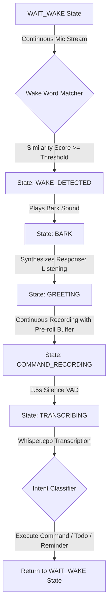

# Morphix Desktop Companion Robot - Voice Assistant

Morphix is a production-ready desktop companion robot featuring a state-of-the-art offline audio pipeline. This voice assistant is designed to operate entirely locally, coordinating wake-word detection, speech-to-text transcription, rule-based intent parsing, local todo/reminder state databases, background notification services, and local text-to-speech synthesis.

---

## 🎙️ Core Audio & Voice Pipeline

The voice assistant architecture coordinates several decoupled sub-components:



### 1. Pre-Speech Ring Buffer (Pre-roll)
To prevent clipping initial spoken consonants (such as the `"H"` in `"Hey Morphix"`), the microphone pipeline maintains a continuous **500ms pre-speech ring buffer**. When Voice Activity Detection (VAD) triggers recording, this buffer is prepended to the final WAV stream sent to Whisper.cpp.

### 2. Algorithmic Wake-Word Matcher
- **Stage 1 (Direct Substring)**: Direct presence matching on **Primary Wake Phrases** (`hey morphix`, `hello morphix`, `hi morphix`, `morphix`, `wake up morphix`) and **Fallback Aliases** is executed first.
- **Stage 2 (Token-Window Fuzzy)**: Sliding token-window matching evaluates candidate windows against target phrases.
- **Weighted Similarity**: Custom alignments weight greeting/filler words (`hey`, `hello`, `you`, etc.) at `0.5` and wake-word variations at `1.0`.
- **False Positive Filter**: Strict word-level validation filters out short mismatched tokens (e.g. rejecting `"hello mona"` and `"and no more f"`), and blocks isolated tokens (e.g. `"fix"`) from triggering the wake loop.

---

## 🛠️ System Requirements & Installation

This project is built using Python 3.9+ and runs entirely offline.

### 1. Install System/Python Dependencies

Clone this repository and install Python requirements:

```bash
pip install -r requirements.txt
```

*Note: On Windows, you may need to install standard audio backends for `sounddevice` or `pygame` if not already present on your system.*

### 2. Set Up Models

#### STT (Speech-to-Text) - Whisper.cpp
Download your preferred Whisper GGUF model binary and save it into the `models/whisper/` directory:

- Default model: `ggml-tiny.en.bin`
- Models directory: `models/whisper/`

#### TTS (Text-to-Speech) - Piper
The assistant uses the local Piper executable:
- Ensure the official `piper` folder and executable are configured.
- Recommended voice model files: `models/piper/` containing `.onnx` and `.onnx.json` model files.

---

## ⚙️ Configuration

Configure the assistant settings inside [config.py](file:///c:/Users/tanis/OneDrive/Pictures/Desktop/Morphix/config.py):

- `WAKE_PHRASE`: `"hey morphix"`
- `SIMILARITY_THRESHOLD`: `0.62` (Adjust threshold values for fuzzy matching sensitivity)
- `DEVELOPMENT_MODE`: Bypass wake-word checks during dev mode (`Config.DEVELOPMENT_MODE = True`).

---

## 🚀 Running the Voice Assistant

Start the Live Voice Assistant Application:

```bash
python run_voice_assistant.py
```

- Whisper backend initialization will suppress verbose C/C++ logs.
- Say `"Hey Morphix"`, `"Game on fix"`, `"More fake"`, or another configured alias to trigger the assistant.
- Speak your command (e.g., `"remind me to feed the cat in five minutes"` or `"add buy groceries to my todo list"`).
- Press `Ctrl+C` to terminate the application cleanly.

---

## 🧪 Running Unit Tests

Automated verification tests are provided for modules:

```bash
# Run Wake Word Detector tests
python -m unittest tests/test_wake_word.py

# Run Voice Assistant Coordinator tests
python -m unittest tests/test_voice_assistant.py
```
